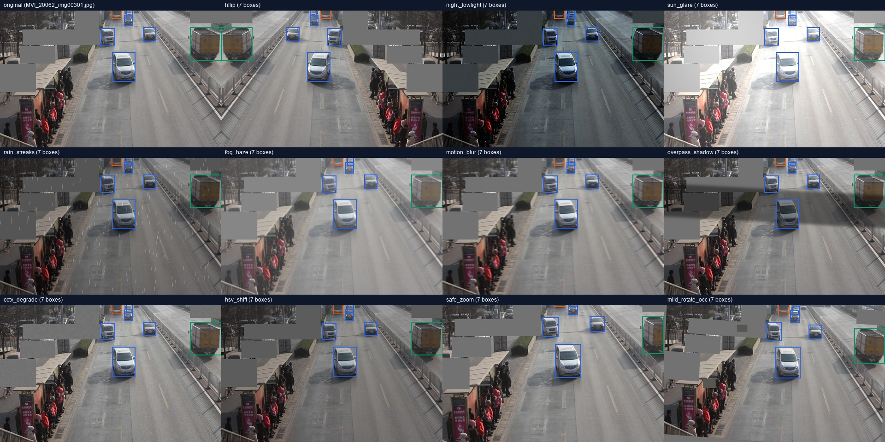

# 🚦 Fed-Traffic-Vision: Çoklu-Kaynak Trafik Araç Tespiti ve Cross-Domain Federal Öğrenme
## 🎓 Lisans Bitirme Projesi (Graduation Thesis Project)

**Fed-Traffic-Vision**, gerçek dünya trafik gözetleme kameralarında sınıf dengesizliği ve alan kayması (*domain shift*) sorunlarını çözmek için **3 tamamlayıcı açık trafik veri setini** birleştiren ve devamında **Flower (`flwr`)** tabanlı **Cross-Domain Federated Learning** mimarisine temel oluşturan modüler bir derin öğrenme projesidir.

[](https://colab.research.google.com/github/aydin-eng/fed-traffic-vision/blob/main/notebooks/01_centralized_3source_yolo11s.ipynb)
[](https://docs.ultralytics.com/)
[](https://flower.ai/)
[](https://www.python.org/)

---

## 🧩 3-Kaynaklı Veri Mimarisi ve Ortak 4-Sınıf Şeması

Tüm kaynaklar tek bir ortak 4-sınıf YOLO şemasında (`car`, `motorcycle`, `bus`, `truck`) birleştirilir ve her karenin kaynak/kamera/hava metaverisi `dataset_metadata.csv` içinde korunur:

| Sınıf ID | Sınıf | UA-DETRAC | MIO-TCD Localization | COCO 2017 |
|---:|---|---|---|---|
| **0** | `car` | `car`, `van` | `car`, `work_van`, `pickup_truck` | `car` |
| **1** | `motorcycle` | *(yok)* | **`motorcycle`** | **`motorcycle`** |
| **2** | `bus` | `bus` | **`bus`** | **`bus`** |
| **3** | `truck` | `others` | **`single_unit_truck`, `articulated_truck`** | **`truck`** |

---

## 🌐 2 Aşamalı Proje Yol Haritası

### Faz 1: 3-Kaynaklı Dengeli Merkezi Baseline (Hazır)
* **UA-DETRAC (`src/data/prepare_detrac.py`):** Video-seviyeli sıfır-sızıntılı (*zero-leakage*) bölme, sınıf-duyarlı adaptive örnekleme (`truck` & `bus` yoğunluklu) ve `<ignored_region>` maskeleme.
* **MIO-TCD Localization (`src/data/prepare_miotcd.py`):** 137.743 karelik Kuzey Amerika sabit CCTV trafik veri setinden `motorcycle` ve ağır vasıta (`single_unit_truck`, `articulated_truck`) öncelikli çıkarım.
* **COCO 2017 Hedefli Alt Küme (`src/data/prepare_coco_subset.py`):** 18 GB arşivin tamamını indirmeden yalnızca azınlık sınıflarını içeren sokak görsellerinin paralel indirilmesi.
* **Colab T4 Pipeline (`notebooks/01_centralized_3source_yolo11s.ipynb`):** Tek tıkla `YOLO11s` (`imgsz=800`) eğitimi ve sınıf bazlı raporlama.

### Faz 2: Cross-Domain Federated Learning (Sıradaki Adım)
Üç veri kaynağı doğrudan gerçekçi **Non-IID İstemciler (Clients)** olarak modellenir:
* **Client 1 (`ua_detrac`):** Doğu Asya otoyol CCTV kameraları (4 hava durumu: `sunny`, `cloudy`, `night`, `rainy`)
* **Client 2 (`mio_tcd`):** Kuzey Amerika kavşak/otoyol CCTV kameraları (yüksek ağır vasıta ve motosiklet yoğunluğu)
* **Client 3 (`coco2017`):** Genel cadde / çoklu kamera açıları

Ham kamera görüntüleri paylaşılmadan yalnızca model ağırlıkları merkezi sunucuda **FedAvg / FedProx** ile birleştirilecektir.

---

## 🧪 Kapsamlı Trafik Veri Artırımı (12-Tarifli Augmentation)

Ortak 3-kaynaklı araç havuzunda (`8.810` train, `1.535` val, `2.397` test) doğrulama ve test kümelerine hiç dokunmadan yalnızca **`train`** kümesindeki nadir araç sınıflarını güçlendirmek için [src/data/augment_minority.py](src/data/augment_minority.py) ile **12 trafik kamerası odaklı augmentation tarifi** uygulanmaktadır:

* **Geometrik & Kamera Açısı:** `hflip` (yatay ayna), `safe_zoom` (`1.12x` güvenli merkez yakınlaştırma + alan koruma filtresi), `mild_rotate_occ` (`±4.5°` kamera eğimi + araç kutularını %35'ten fazla örtmeyen yol kenarı kısmi engeli)
* **Hava & Aydınlatma:** `night_lowlight` (gama karartma + ISO gürültüsü), `sun_glare` (güneş parlaması), `rain_streaks` (eğik yağmur çizgileri), `fog_haze` (sis/pus), `overpass_shadow` (üst geçit gölgesi)
* **Sensör & Bileşik:** `motion_blur`, `cctv_degrade` (sensör gürültüsü + JPEG Q=45 sıkıştırma), `hsv_shift`, `combo_night_flip`
* **Katmanlı Sınıf Dengeleme:** `motorcycle`/`bus` içeren karelere **+2 kopya**, yalnızca `truck` içeren karelere **+1 kopya**, `car`-only karelere **0 kopya**.



| Sınıf | Ham Train Kutusu | **Artırılmış Train Kutusu** | Kazanım | `car:sınıf` Oranı (Önce → Sonra) |
|---|---:|---:|---:|---|
| **`car`** | 33.153 | **83.353** | 2.51× | — |
| **`motorcycle`** | 3.497 | **10.488** | **3.00×** | `9.48:1 → 7.95:1` |
| **`bus`** | 3.184 | **9.534** | **2.99×** | `10.41:1 → 8.74:1` |
| **`truck`** | 6.667 | **14.725** | **2.21×** | `4.97:1 → 5.66:1` |
| **Toplam Train Görsel** | **8.810** | **21.908** *(+13.098)* | **2.49×** | `val` (`1.535`) & `test` (`2.397`) dokunulmadı |

---

## 📁 Dizin Yapısı

```text
fed-traffic-vision/
├── configs/
│   └── dataset_schema.yaml                 # Ortak 4 sınıf ve 3 kaynak eşleme şeması
├── src/
│   ├── data/
│   │   ├── common.py                       # Unicode I/O, maskeleme, YOLO & metadata yardımcıları
│   │   ├── prepare_detrac.py               # UA-DETRAC adaptive & masked extractor
│   │   ├── prepare_miotcd.py               # MIO-TCD Localization extractor
│   │   ├── prepare_coco_subset.py          # COCO 2017 targeted fetcher
│   │   ├── augment_minority.py             # Train-only nadir sınıf augmentation
│   │   └── build_unified_dataset.py        # 3-kaynaklı orkestratör
│   └── federated/                          # Faz 2: Flower FL istemci/sunucu modülleri
├── docs/
│   ├── augmentation_preview.jpg            # 12 tarifli trafik augmentation görsel önizlemesi
│   └── augmentation_report.json            # Sınıf & oran bazlı augmentation raporu
├── notebooks/
│   └── 01_centralized_3source_yolo11s.ipynb # Colab T4 3-kaynaklı eğitim notebook'u
├── test_samples/
│   └── user_test_photo.jpg                 # Bağımsız saha test fotoğrafı
├── detrac_xml_annotations.zip              # Resmi UA-DETRAC XML etiket paketi
├── requirements.txt
└── README.md
```
